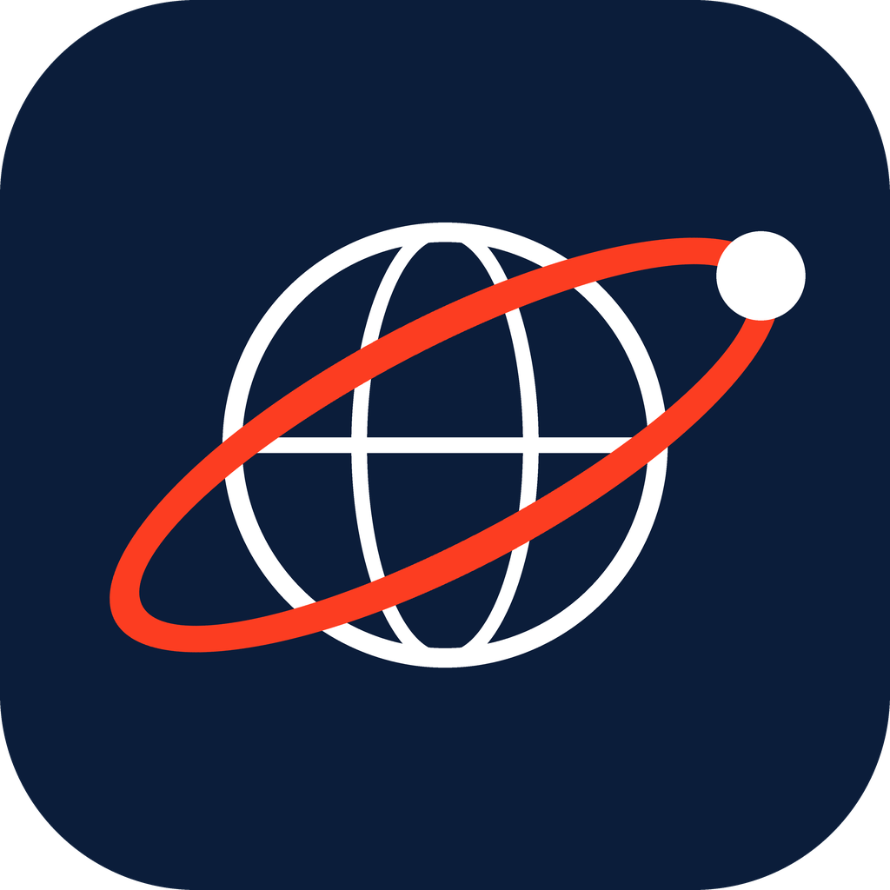

<div align="center">



# SATELLITE TRACKER

**Dünya yörüngesindeki aktif uyduları gerçek yörünge verisiyle 3D Dünya üzerinde takip eden uygulama: Windows ve Android**


*Furkan tarafından geliştirildi*

</div>

---

## Özellikler

- **Gerçekçi 3D Dünya:** NASA Blue Marble dokusu, gerçek zamanlı gece-gündüz sınırı, şehir ışıkları, atmosfer kenar parlaması ve hafif bulut katmanı. Dünya, Greenwich yıldız zamanına (GMST) göre döner.
- **Aktif uyduların tamamı:** CelesTrak "active" listesi, 2026 itibarıyla 16.000'den fazla uydu. Uydular kategori renkleriyle gösterilir. Yakınlaştırınca adları, uzaklaştırınca sade noktaları görünür.
- **Seçili uydu için:** Kırmızı işaret, hareket yönü oku, bir tam periyotluk yörünge çizgisi, yumuşak kamera odağı, takip modu ve bilgi kartı (ülke, hız, yükseklik, konum, yörünge, fırlatma tarihi, eleman tarihi).
- **Arama ve filtreleme:** Ada, ülkeye/sahibe ve NORAD numarasına göre arama. Tür, ülke ve yörünge sınıfı (LEO/MEO/GEO/HEO) filtreleri.
- **Veri doğruluğu önceliklidir:** Hesaplanan her değer "hesaplanan" etiketiyle gösterilir. Bilinmeyen bilgi uydurulmaz, yerine "Veri mevcut değil" yazar.
- **Çevrimdışı çalışma:** Son veriler önbellekte kalır. Bağlantı kesilince konumlar dondurulur ve hiçbir yapay hareket üretilmez. Bağlantı gelince veri otomatik olarak yenilenir.
- **Performans:** SGP4 hesabı ayrı bir Web Worker'da yapılır. Uydular tek GPU çizim çağrısıyla çizilir, liste sanal kaydırma kullanır. Windows ve Android için ayrı profiller vardır ve FPS düşerse kalite otomatik olarak azalır.
- **Bildirim yoktur:** Uygulama hiçbir bildirim, ses veya açılır pencere göstermez. Durum bilgisi yalnızca uygulama içinde görünür.

## Veri doğruluğu: önemli açıklama

Ücretsiz kaynakların hiçbiri (CelesTrak, Space-Track, N2YO dahil) binlerce uydu için **doğrudan ölçülmüş canlı konum yayınlamaz**. Bu kaynaklar **yörünge elemanı** yayınlar (GP / OMM, eski adıyla TLE). Sektördeki bütün takip uygulamaları konumu bu elemanlardan **SGP4/SDP4** modeliyle hesaplar.

Bu uygulama da aynı yöntemi kullanır ve bunu gizlemez:

| Bilgi | Kaynak | Arayüzdeki etiket |
|---|---|---|
| Ad, NORAD no, yörünge elemanları, eleman tarihi | CelesTrak GP (OMM/CSV) | `CELESTRAK` |
| Ülke/sahip, fırlatma tarihi | CelesTrak SATCAT | `SATCAT` |
| Kategori (haberleşme, meteoroloji…) | CelesTrak GP grup üyeliği | kategori rozeti |
| Konum, yükseklik, hız, yörünge çizgisi | SGP4 ile **hesaplanan** | `HESAPLANAN` |
| LEO/MEO/GEO/HEO sınıfı | Kaynağın ortalama hareket ve dışmerkezlik değerinden, belgelenmiş kuralla | `CELESTRAK` |

Ayrıntılar için [docs/VERI_KAYNAKLARI.md](docs/VERI_KAYNAKLARI.md) dosyasına bakın.

## İndirme

Derlenmiş dosyalar **GitHub Releases** sayfasında yer alır. Bunlar, `v*` etiketiyle GitHub Actions tarafından otomatik olarak üretilir.

| Dosya | Açıklama |
|---|---|
| `SatelliteTracker-x.y.z-Windows-Setup.exe` | Windows 10/11 kurulum sihirbazı (Türkçe, yönetici izni gerekmez) |
| `SatelliteTracker-x.y.z-Windows-Portable.exe` | Kurulum gerektirmeyen tek dosya (WebView2 gerekir; Windows 10/11'de hazır bulunur) |
| `SatelliteTracker-x.y.z-Android.apk` | Android 5.1+ (API 22); güncel Android System WebView önerilir |

### Kurulum

**Windows:** `Setup.exe` dosyasını çalıştırın. SmartScreen uyarısı çıkarsa *Ek bilgi → Yine de çalıştır* yolunu izleyin (uygulama kod imzalama sertifikası olmadan yayımlanmaktadır).
**Android:** APK'yı telefona indirin. *Bilinmeyen kaynaklardan yüklemeye izin ver* seçeneğini açın ve dosyayı kurun.

### Kullanım

| İşlem | Masaüstü | Dokunmatik |
|---|---|---|
| Dünya'yı döndürme | Sol tık + sürükleme | Tek parmakla sürükleme |
| Yakınlaştırma | Fare tekerleği | İki parmakla kıstırma |
| Uydu seçme | Uyduya veya listedeki satıra tıklama | Dokunma |
| Arama | `/` | Alt paneldeki arama kutusu |
| Listeyi aç/kapat | `L` veya ☰ | Alt paneli yukarı/aşağı kaydırma |
| Takip modu | `F` veya *Takip et* | *Takip et* |
| Seçimi kaldırma | `Esc` | Kartı kapatma |

## Geliştirme

Gereksinimler: Node.js 22.13+ ve Python 3 + Pillow (yalnızca ikon üretimi için). Windows sürümü için Rust ve Tauri ön koşulları, Android sürümü için JDK 17 ve Android SDK gerekir.

```bash
npm install
npm run textures      # NASA dokularını indirir (bir kez)
npm run dev           # http://localhost:5173
npm run typecheck     # TypeScript tip denetimi
npm test              # birim testleri (SGP4 doğruluk testleri dahil)
npm run build && npm run test:e2e   # uçtan uca duman testi (Chromium)
```

**Windows paketi:** `npm run build:windows` komutu `src-tauri/target/release/bundle/nsis/` altında kurulum dosyası üretir.
**Android paketi:** `npm run build && npm run android:init && npx cap sync android` komutlarından sonra `android/` klasöründe `./gradlew assembleDebug` çalıştırın.

### İmzalı Android sürümü (isteğe bağlı)

Depo ayarlarında şu *Actions secrets* değerleri tanımlanırsa CI, imzalı bir release APK üretir. Tanımlanmazsa hata ayıklama imzalı (yine kurulabilir) bir APK üretilir.

`ANDROID_KEYSTORE_BASE64` · `ANDROID_KEYSTORE_PASSWORD` · `ANDROID_KEY_ALIAS`

```bash
keytool -genkeypair -v -keystore release.keystore -alias satellitetracker -keyalg RSA -keysize 2048 -validity 10000
base64 -w0 release.keystore   # çıktıyı ANDROID_KEYSTORE_BASE64 olarak kaydedin
```

## Mimari

```
src/
├─ core/        Platformdan bağımsız mantık: ayrıştırma, sınıflandırma, veri servisi, önbellek (birim testli)
├─ worker/      SGP4 hesap işçisi (satellite.js), ana iş parçacığını bloklamaz
├─ render/      Three.js 3D Dünya, GLSL gölgelendiriciler, seçim/odak/takip
├─ ui/          Arayüz: paneller, sanal liste, bilgi kartı, açılış ekranı
└─ main.ts      Bileşenleri birbirine bağlar
src-tauri/      Windows kabuğu (Rust): izinli alan adlarıyla sınırlı HTTP köprüsü
scripts/        Doku indirme, ikon üretimi, Android son ayarları
tests/ e2e/     Birim testleri (node:test) ve Playwright duman testi
```

Ayrıntılar: [docs/MIMARI.md](docs/MIMARI.md) · Test sonuçları: [docs/TEST_RAPORU.md](docs/TEST_RAPORU.md)

## Lisanslar ve teşekkür

- Kod: MIT © 2026 Furkan
- Yörünge verisi ve SATCAT: [CelesTrak](https://celestrak.org) (Dr. T.S. Kelso)
- Dünya görüntüleri: NASA Visible Earth (Blue Marble, Earth's City Lights). NASA görselleri kamu malıdır.
- [Three.js](https://threejs.org) (MIT) · [satellite.js](https://github.com/shashwatak/satellite-js) (MIT) · [Tauri](https://tauri.app) (MIT/Apache-2.0) · [Capacitor](https://capacitorjs.com) (MIT)

> Bu proje NASA ile bağlantılı değildir. "NASA tarzı" ifadesi yalnızca görsel tasarım dilini anlatır. Uygulamada NASA logosu kullanılmaz.
